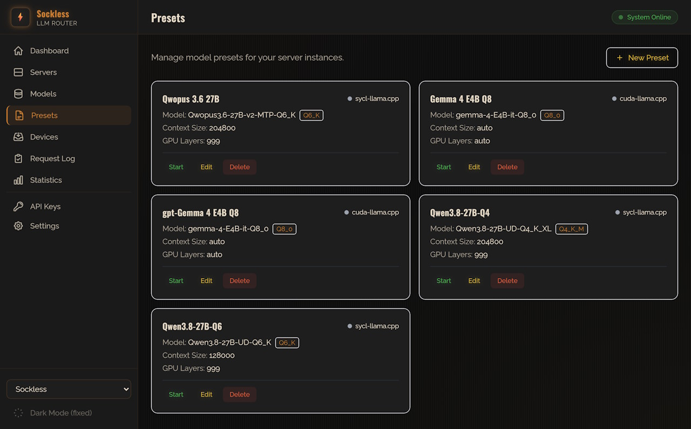
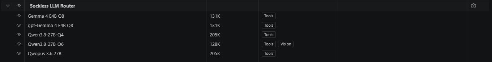
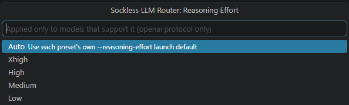

# Sockless LLM Router — Copilot Chat Provider

Use models served by your local [Sockless LLM Router](https://www.sockless.tech/projects/sockless-llm-router/) as Copilot Chat models in VS Code. Point the extension at the router's API endpoint and its models appear in the Copilot model picker automatically — no manual per-model configuration.

Sockless LLM Router is a local gateway that manages and launches model server presets (llama.cpp, etc.) and exposes them behind OpenAI- and Anthropic-compatible APIs. See the [project page](https://www.sockless.tech/projects/sockless-llm-router/) and [GitHub repo](https://github.com/sockless-coding/llm-router) for setup and preset configuration.

## Screenshots

Presets configured in the router's admin UI (`Presets`) show up automatically in the Copilot Chat model picker, with context size and tool/vision support carried over:





Reasoning effort is set globally from the Command Palette or status bar, and only applied to presets that support it:



## Setup

1. Install the extension and run **Sockless LLM Router: Configure Connection** from the Command Palette (or open the Copilot model picker — it will prompt you the first time).
2. Enter the router's **API endpoint URL** (the API port, e.g. `http://localhost:5054` — not the admin UI's `5053`).
3. Optionally enter an **API key**, only needed if the router's gateway has "Require API Key" enabled. The key is stored in VS Code's secret storage, never in settings.
4. Open the Copilot Chat model picker — every server preset configured in the router shows up as a model, with the model picker reflecting each one's context size and whether it supports tools/vision.

To change the endpoint or key later, run **Sockless LLM Router: Configure Connection** again.

## How model discovery works

On connect, the extension calls the router's `GET /v1/models/capabilities` endpoint, which reports — per preset — context length, max output tokens, and whether tool calling / image input are supported. That's what lets VS Code populate the model picker without asking you to describe each model by hand.

## Reasoning effort

VS Code's model picker has no per-model "submenu" UI for a BYOK provider the way it does for Copilot's own GPT-5/o-series models — every entry `provideLanguageModelChatInformation` returns is just a flat, separate row in the picker. Rather than clutter the picker with a near-duplicate row per effort level, reasoning effort is a single global setting, shown and changed from the **Reasoning: …** status bar item (bottom right) — click it, or run **Sockless LLM Router: Set Reasoning Effort** from the Command Palette, to pick Auto/Low/Medium/High/XHigh.

The chosen level is sent as `reasoning_effort` on `/v1/chat/completions`, but only for a request to a preset the router reports as supporting it (`supports_reasoning_effort`) — it's silently omitted for any other model, so the one global setting never affects a model that doesn't understand it. A preset that does support it shows `reasoning` in its picker detail text as a hint.

This only applies to the `openai` protocol — the router doesn't yet translate a reasoning-effort level onto its `claude`-protocol `/v1/messages` path, so the setting has no effect while **Sockless LLM Router: Protocol** is `claude`.

## Protocol

The router speaks two chat protocols side by side, and this extension can use either one — set **Sockless LLM Router: Protocol** (`socklessLlmRouter.protocol`) to:

- `openai` (default) — `POST /v1/chat/completions`, the router's OpenAI-compatible endpoint.
- `claude` — `POST /v1/messages`, the router's Anthropic-compatible endpoint.

Both protocols expose the same presets with the same tool-calling and image-input support, so this is mainly for comparing behavior between the two or matching another Claude-protocol client talking to the same router.

## Requirements

- A running Sockless LLM Router instance with at least one server preset configured.
- VS Code 1.104 or newer (for the Language Model Chat Provider API).

## Links

- Sockless LLM Router — [project page](https://www.sockless.tech/projects/sockless-llm-router/) · [GitHub](https://github.com/sockless-coding/llm-router)

## Development

```
npm install
npm run compile
```

Press F5 in VS Code to launch an Extension Development Host with the provider loaded.
